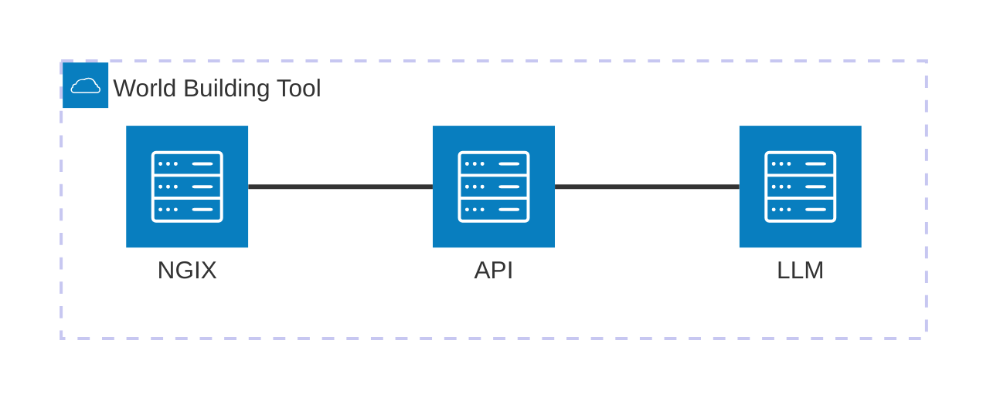

# LLM Service

LLM gatweay for [world building tool](https://github.com/bllflt/worldbuildingtools/blob/main/README.md) application

Concept:
  - Centralize all the LLM related code into a service
  - Easier to add cost/token monitoring
  - Help reduce risk of LLM API key exposure by not having it in the 
    UI facing REST API service.

